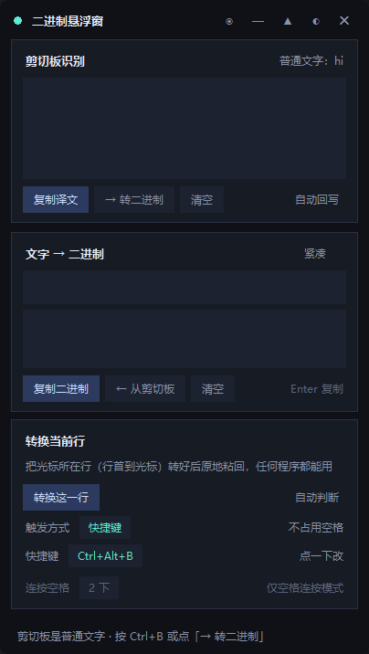

# 二进制悬浮窗 · BinFloater

一个常驻桌面的小悬浮窗：**复制 0/1 串就自动翻译成文字**，也能把文字转成二进制，
还能在任意程序里把光标所在那一段**就地转换完粘回去**。

二进制、十六进制、Base64、摩斯码四种格式都认，双向都能转。

> **这个项目全部由 AI 制作。**
> 代码、图标、打包配置、这份文档，全部由 AI 编写。人类只负责提需求和在真机上试用。
> 详见[关于作者](#关于作者)。



## 下载与运行

两种用法，按自己的习惯挑：

**安装版（推荐）**：到 [Releases](../../releases) 下载 `BinFloater-Setup-x.y.z.exe`，双击安装。

- 安装时会让你选装到哪个盘，**默认挑第一个不是 C 盘的硬盘**（`D:\Programs\BinFloater` 这样）。
  只有 C 盘的机器才退回用户目录。
- 装在 C 盘不会被拦，但会先问你一句确认。
- 装到非系统盘的好处：重装系统不用重装它，也不占系统盘空间。
- **配置跟着安装目录走**，装在 D 盘 `config.json` 就在 D 盘，不往 `%APPDATA%` 里丢东西。
  设置界面底部能看到实际路径，点一下直接打开那个文件夹。
- 卸载在「设置 → 应用」里，点一下就干净了。
- 升级直接装新版本，会识别成同一个软件，不用先卸载。

**免安装版**：下载 `BinFloater.zip`，解压后双击 `BinFloater.exe`。

免 Python 环境，但**整个文件夹一起拷走**才能用（不要只拷 exe）。免安装版的配置写在
`%APPDATA%\BinFloater\config.json`——没走安装流程，程序目录不一定是固定的可写位置。

支持 Windows 10 / 11。

## 功能

### 1. 剪切板自动翻译（多重格式 → 文字）

在任意程序里复制一段 0/1 串，悬浮窗会立刻显示译文：

| 复制的内容 | 识别结果 |
| --- | --- |
| `01001000 01101001` | `Hi` |
| `0100100001101001` | `Hi` |
| `0b01001000_0b01101001` | `Hi` |
| `0100-1000 0110-1001` | `Hi` |
| `48 69` | `Hi`（十六进制） |
| `SGk=` | `Hi`（Base64） |
| `.... . ..` | `HI`（摩斯码） |
| `111001001011110110000000...` | 中文（UTF-8） |

支持的分隔风格：空格、换行、逗号、分号、下划线、短横线、`0b` 前缀，以及完全连写。
编码按 `UTF-8 → GBK → Big5 → Latin-1` 依次尝试，中文和 emoji 不会乱码；
落到 Latin-1 兜底且含高位字节时会明确提示「可能是乱码」，不会假装解码成功。

识别不只看字符集，还会**真解一遍看结果像不像文字**。所以 `HelloWorld`、
`password123`、`Supercalifragilistic` 这些「字面上完全符合 Base64」的英文单词
不会被误判成一屏乱码；`...`、`---` 这种随手打的符号也不会被当成摩斯码。
带 `=` 填充的短 Base64 反而认得出来（`YQ==` → `a`）。

复制普通文字时不会打扰你，只会在状态栏提示可一键转编码。角标只显示固定的
「普通文字」，内容摘要放在状态栏——早先把摘要写进角标，一长就把旁边的
「暂停」键挤出窗口。

### 2. 文字 → 编码

在下方输入框里打字，结果**实时**显示在下方：

- `Hello 世界` → `01001000 01100101 ...`（UTF-8 编码）
- 点「复制编码」或按 **Enter** 一键复制
- 「格式」在 二进制 / 十六进制 / Base64 / 摩斯码 之间循环
- 「分隔符」在 空格 / 逗号 / 换行 / 紧凑 / `0b` 前缀 之间循环
- 点「← 从剪切板」把剪切板里的文字拉进输入框
- 「多行批量」把剪切板里的每一行各自转换一次，空行原样保留
- 「从文件读」/「导出结果」读写文本文件；「解码为文件」把 0/1 串还原成字节存盘（还原图片、压缩包用）
- 直接把文件**拖进窗口**也行：文本文件读进输入框，二进制文件编成 0/1 串
  （不是文本的文件最大 512KB；超长文本不会塞进输入框，直接转换好放结果区）

### 3. 就地转换当前行 / 选中内容

在**任何程序**里打了一段字，不用复制粘贴到悬浮窗，直接触发转换：它会把
「光标所在行、行首到光标」那一段换成编码（或反过来），然后原地粘回。

```
你在聊天框里打：  hello      ← 光标在最后
按下 Ctrl+Alt+B： hello 变成 01101000 01100101 01101100 01101100 01101111
```

同一个键再按一次就转回来——转换方向默认是**自动判断**（看内容是文字还是 0/1 串）。

需要跨多行时，先在程序里**选中**那一段，再点「转换选中」：整体当一段文字处理，
粘回时替换掉整个选区。没选中则不动任何东西，光标和文档一个字都不碰。

#### 触发方式

「转换当前行」卡片上有独立的**触发方式**一行，点一下切换三档：

| 模式 | 触发 | 代价 |
| --- | --- | --- |
| **快捷键**（默认） | `Ctrl+Alt+B` | 不占用空格 |
| 空格连按 | 连按若干下空格 | 会吃掉这几个空格 |
| 关闭 | —— | 不占键盘钩子 |

**快捷键可以自己设**：点「快捷键 `Ctrl+Alt+B`」那一行，它会变成「按下新的组合键…」，
直接在键盘上按你想要的组合即可（必须带 Ctrl / Alt / Shift / Win 至少一个），
按 `Esc` 取消。改完立刻生效，不用重启。

**空格连按的次数也能调**（1~5 下，默认 2 下）：在「连按空格」那一行点数字循环切换。
玩游戏时容易误触就调到 3 下或更多。

#### 转换方向

三档：**自动判断**（默认）、文字→二进制、二进制→文字。点卡片右下角那两个字切换。

#### 它是怎么做到的

不走 UI Automation（Windows 没有通用的「读取别的程序输入框」接口，各家实现差异极大），
而是模拟选中 → `Ctrl+C` 复制 → 转换 → `Ctrl+V` 粘回。
凡是能编辑的地方都支持，包括微信、浏览器、IDE、游戏聊天框。

剪切板在转换完会还原成你原来的内容，不会被占掉。

### 4. 收进托盘，快捷键照样能用

点标题栏的「—」把悬浮窗收进系统托盘。收起来之后**触发依然有效**——
钩子是常驻的，窗口藏起来不影响它。

第一次收进托盘时会弹一条 Windows 气泡通知提醒你「软件在托盘，怎么触发依然可用」，
免得你以为它退出了。通知里说的是**你当前设的触发方式**，不是写死的快捷键：

| 当前模式 | 通知内容 |
| --- | --- |
| 快捷键 `Ctrl+Alt+B` | 悬浮窗收到托盘了，按 Ctrl+Alt+B 依然可用。 |
| 空格连按（3 下） | 悬浮窗收到托盘了，连按 3 下空格依然可用。 |
| 关闭 | 悬浮窗收到托盘了。触发已关闭，需要时从托盘叫回来。 |

托盘图标的悬停提示也是同样的逻辑，跟着当前模式走。
右键有菜单（显示窗口 / 退出），左键点一下就把窗口叫回来。

### 5. 顺手的小功能

- **转换历史**：最近 20 条转换记在内存里，点一条就复制；只存在内存不落盘，剪切板内容不会被写到硬盘上
- **⇄ 反向**：把当前结果再转回去，来回对照用
- **锁定译文**：剪切板一直在变的时候，把当前译文钉住不被冲掉
- **‖ 暂停**：临时不要监视剪切板（复制密码之类的时候用），恢复时不会把暂停期间攒下的内容一股脑倒出来
- **自动回写**：识别到编码后，自动把译文写回剪切板（默认关闭，点一下开启）
- **折叠**：点 ▲ 收成一条标题栏，折叠时标题栏直接显示译文，不挡视线
- **不透明度**：点 ◐ 在 100% / 92% / 80% / 65% 之间快速切换，设置里还有一条连续滑块
- **宽度可调**：设置里拖滑块，340 ~ 760px
- **置顶**：点 ◉ 切换窗口置顶（青色表示已置顶）
- **收进托盘**：点 — 最小化到托盘，触发继续可用
- **恢复默认设置**：一键把触发方式、快捷键、格式、不透明度全复位（窗口位置不动）
- **检查更新**：设置里能看到当前版本，点「检查更新」问一次 GitHub 有没有新版；查到后能**在应用内下载并安装**，不用跳浏览器。默认每天启动查一次，可以关掉。详见下一节
- 窗口位置、宽度、触发方式、快捷键、连按次数、透明度、格式和各项开关都会自动记住，改完即时保存，不用点保存按钮
- 单实例运行：重复双击不会开第二个窗口，而是把已有窗口提到最前（收在托盘里也能叫回来）
- 第一次运行会在状态栏提示怎么用，只提示一次

### 6. 检查更新

设置卡片最下面两行：一行是当前版本和按钮，一行是自动检查开关。

| 情况 | 界面上怎么写 | 按钮 |
|---|---|---|
| 还没查过 | `v1.6.0` | 检查更新 |
| 查到新版 | `v1.6.0 · 有新版本 v1.7.0` | **下载并安装** |
| 下载中 | `v1.6.0 · 下载中 45%` | 取消 |
| 下载完 | `v1.6.0 · 安装包已就绪` | **安装** |
| 已是最新 | `v1.6.0 · 已是最新` | 检查更新 |
| 仓库还没公开 | `v1.6.0 · 仓库还没公开，读不到发布信息` | 检查更新 |
| 网络不通 | `v1.6.0 · 连不上 GitHub：…` | 检查更新 |

### 怎么升级

点一下就够了：**检查更新 → 下载并安装 → 安装**。

1. 查到新版后按钮变成「下载并安装」，点下去就在后台下载安装包（状态栏有百分比），进度中按钮变「取消」，随时能停
2. 下完按钮变「安装」，点一下：程序自己先退出，然后把安装程序拉起来
3. 安装向导正常走（能选安装路径，默认还是非 C 盘），装完就是新版

下载的东西放在配置文件旁边的 `updates` 子文件夹里，安装完可以自己删，也可以留着。

### 为什么要先退出程序

`BinFloater.exe` 和 `_internal` 里的 dll 正在被占着，安装程序没法覆盖它们。所以点「安装」时程序会先把自己完整关掉（存配置、卸托盘、撤键盘钩子），然后才启动安装向导。

真正动手装的是 Inno Setup，不是程序自己改自己——那才是真正危险的做法（杀软必拦）。

几个说清楚的设计：

- **一天只自动查一次。** 匿名调 `api.github.com` 限 60 次/小时（按 IP），一天开关十几次就把额度用完了，真需要查的时候反而 403。查过就记下日期，同一天再启动直接跳过。
- **下载会验 sha256。** GitHub 给每个附件都返回 digest，下完自己对一遍。不对就不存盘，也不告诉你「装好了」然后给你个坏包。
- **半途断了不留垃圾。** 先写 `.part`，验过才改成真名。这样你不会在文件夹里看到一个看着像安装包、双击却报「文件损坏」的碎文件。
- **网络请求全在后台线程。** Tk 不是线程安全的，后台线程只往队列里塞结果，由主线程的 `after` 循环去取。下载进度也走同一条路。
- **能在设置里关掉自动检查。** 不想让程序联网就点「自动检查 开」变成关，之后只有手动点才会查。
- **仓库是私有的时候不会报成「网络故障」。** GitHub 对私有仓库的匿名请求返回 404（不区分「不存在」和「没权限」），所以这里单独归成一种状态，直接告诉你是仓库没公开。
- **只有 zip 的旧版本会退回浏览器。** 万一某个 Release 只传了 zip，不会把 zip 当 exe 去跑，而是把下载页开出来。

## 快捷键

| 快捷键 | 作用 |
| --- | --- |
| `Ctrl+Alt+B` | 转换光标所在行 / 选中内容（**可自定义**） |
| `Enter`（输入框内） | 复制编码 |
| `Ctrl+B` | 把剪切板文字转成编码 |
| `Ctrl+Q` | 退出 |
| `Esc` | 折叠 / 展开（录制快捷键时是取消） |
| 双击标题栏 | 折叠 / 展开 |
| 拖动标题栏或空白处 | 移动窗口 |

把这些快捷键写进输入框时不会误触发（输入框里的按键只归输入框管）。
自定义快捷键若和系统组合撞车（比如 `Win+L`、`Alt+F4`），保存时会明确警告，
但不拦你——被占的组合我们照样能收到按键，只是目标程序也会同时收到。

## 命令行用法

```bash
BinFloater.exe --decode "01001000 01101001"   # 输出 Hi
BinFloater.exe --encode "Hi"                  # 输出 01001000 01101001
BinFloater.exe --version                      # 输出 BinFloater 1.4.0
```

## 说明

- 只识别 **Unicode 文本**格式的剪切板内容；图片、文件、HTML 等格式会被忽略。
- 二进制判定阈值：去掉分隔符后至少 16 位，且只由 0/1 组成。像 `2024` 这类纯数字不会被误判。
- 位数不是 8 的倍数时，末尾会自动补 0 并在状态栏提示。
- 拖进来的文件如果不像文本（含 `\x00`，或解开后控制字符超过 2%），会按二进制处理。
  以前靠「GBK 能不能解开」判断，但 GBK 的编码空间几乎覆盖所有字节序列，
  图片会被解成一串无意义汉字再编码回去就对不上原文件了。
- 输入框最多放 2000 字。`Entry.insert` 的耗时是超线性的（实测 5 千字 0.44 秒、
  2 万字 5.9 秒、5 万字 36 秒），不设上限的话拖个大文本进来界面就假死。
  超过上限的文字不进输入框，直接转换好放在结果区，并说明原因。
- 配置保存位置跟着程序走：**安装版放安装目录**（装在 D 盘就在 D 盘），免安装版放
  `%APPDATA%\BinFloater\config.json`。判断依据是「程序目录能不能写」——写在需要管理员
  权限的目录下，就退到用户目录。设置界面底部会显示实际路径，点一下打开那个文件夹。
  写入是先写临时文件再原子替换，所以杀进程、崩溃、断电都不会把它写坏；万一下次启动
  读不出来，会先把坏掉的那份备份成 `config.json.bad`，再退回默认值，同时把原因记进
  同目录的 `error.log`。配置里的值读出来时会做类型校验，手改坏了也只是那一项回默认值，
  不会启动失败。
- 从 1.3 及更早版本升级上来时，如果新位置还没有配置而老的 `%APPDATA%` 里有，会
  自动复制一份过来，设置不用重设。老文件保留不动，想退回去用旧版本也不受影响。
- 每次启动，状态栏会先报一句恢复了什么设置（比如 `已恢复：空格连按 ×4`），
  想确认「到底记住没有」看这一行就够了。

## 许可

MIT，见 [LICENSE](LICENSE)。

## 关于作者

**这个项目全部由 AI 制作。**

Python 代码、图标生成、打包配置、这份文档，全部是 AI 写的。
人类的角色是提需求、在真机上试用、指出哪里不对，然后由 AI 定位原因并改。
整个过程中没有手写过一行业务代码。

AI 工具：[DeepSeek Harness](https://github.com/deepseek-ai)（DeepSeek-V4 系列模型）。
需求提出与真机验收：[BlestHeart](https://github.com/BlestHeart)。

之所以明说，是因为这确实是个能用的东西——但它不是人写的，这一点不应该被含糊过去。

## 相关

- **[BinFloater-Android](https://github.com/BlestHeart/BinFloater-Android)** —— 安卓版：同一套编解码核心的悬浮窗实现，点一下读剪切板（独立仓库）
